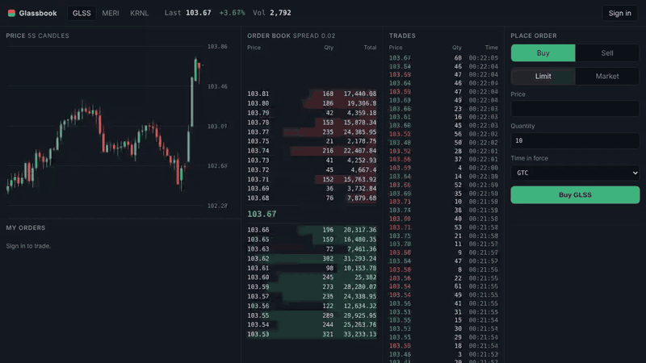
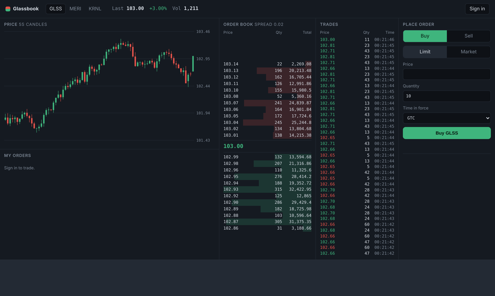
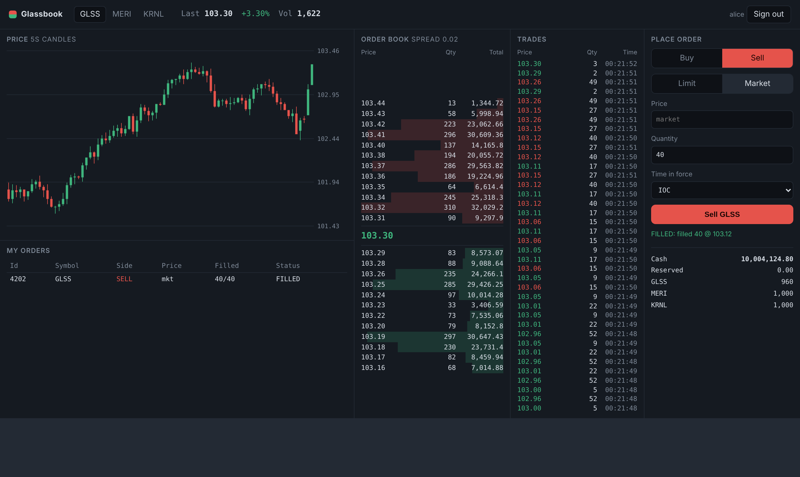
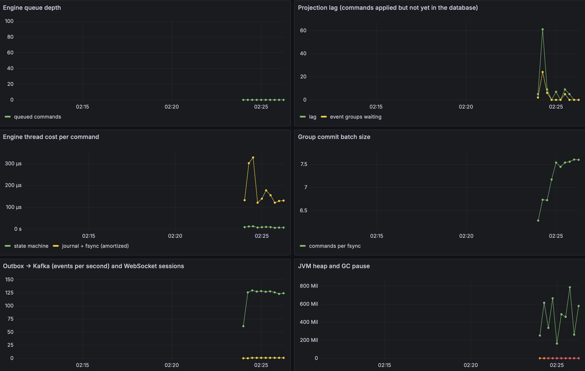
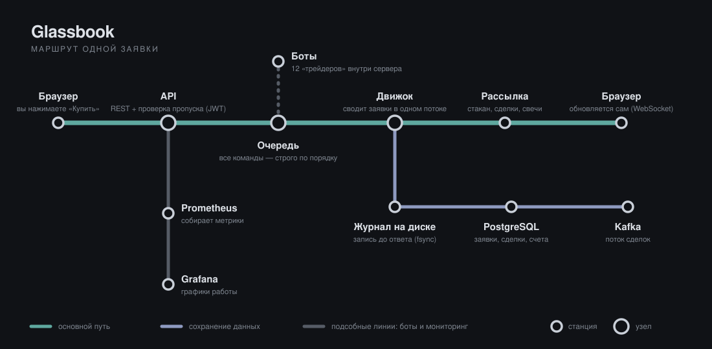

# Glassbook

  

Учебная биржа, написанная на Java: стакан заявок, сделки, веб-интерфейс, боты-трейдеры и мониторинг.

Запускается одной командой через Docker. Настоящих денег здесь нет, всё игровое.

  



## Как создавался проект

Проект старался реализовывать сам, но в некоторых местах мне помогли сторонние источники, и об этом нужно сказать прямо.

**Веб-интерфейс** (`exchange-server/src/main/resources/static`) создан с помощью нейросети.
Фронтенд я не знаю, а человека, который мог бы этим заняться, не нашлось. Мне хотелось,
чтобы биржей можно было пользоваться не только через API, поэтому я описал, как должен выглядеть
и работать интерфейс, и Grok/Claude написали HTML, CSS и JavaScript. Я проверил, что он работает
с моим сервером. Весь остальной проект (движок, сервер, база данных, мониторинг) сделан мной.

**Использование SHA-256** (подпись токенов входа и контрольная сумма снимков состояния движка)
я частично взял из статей в интернете, а частично реализовал с помощью Grok/Claude.
Сам алгоритм я не придумывал и не писал, а использую стандартные реализации из Java и Spring Security.
Я понимаю, что именно он делает и зачем он нужен в этих местах.

**Написание тестов** также я пока что не постиг, поэтому оставил реализацию на Grok/Claude.


Java 21 · Spring Boot 3.5 · PostgreSQL 16 · Kafka · Docker Compose · Prometheus + Grafana

  

## Почему этот проект

  

> Брокерские приложения выглядят простыми, но под ними живёт много неочевидного. Порядок заявок, резервирование денег, что будет, если сервер упадёт посреди сделки, множество вопросов. Читать об этом мне было мало, поэтому я решил написать свою маленькую "биржу" и разобраться руками. Glassbook получился не быстрым и не «боевым», зато в нём я сам прошёл весь путь заявки от стакана до журнала на диске и графиков в Grafana


  

## Быстрый старт

  

Нужны только Docker и Git (или просто браузер, чтобы скачать архив).

  

```bash

git clone https://github.com/richMILL0/glassbook.git

cd glassbook

docker compose up --build

```

  

Первый запуск занимает от 5 до 15 минут: Docker скачивает образы и собирает проект.

Когда в логах появится `Started GlassbookApplication`, откройте <http://localhost:8080>.

  

Дальше подробная инструкция для тех, кто делает это впервые.

  

| Адрес | Что там | Вход |

| <http://localhost:8080> | сама биржа | создаёте аккаунт на странице |

| <http://localhost:3000> | Grafana, графики работы | `admin` / `admin` |

| <http://localhost:9090> | Prometheus, сырые метрики | не нужен |

  

Остановить: `Ctrl+C` в терминале, затем `docker compose down`.

Остановить и удалить все данные: `docker compose down -v`.

  

## Подробная инструкция для новичков

  

**1. Установите Docker Desktop.**

Скачайте с [docker.com](https://www.docker.com/products/docker-desktop/) версию для своей системы,

установите и запустите. Подождите, пока внизу слева появится статус Running.

На Windows Docker при первом запуске может предложить включить WSL 2 и перезагрузиться, соглашайтесь.

  

**2. Скачайте проект.**

Если Git не установлен, откройте <https://github.com/richMILL0/glassbook>, нажмите зелёную кнопку

Code, затем Download ZIP, и распакуйте архив в любую папку.

Если Git есть, выполните `git clone https://github.com/richMILL0/glassbook.git`.

  

**3. Откройте терминал в папке проекта.**

Внутри папки должны лежать файлы `docker-compose.yml` и `Dockerfile`.

  

- Windows: откройте папку в Проводнике, в адресной строке напишите `cmd` и нажмите Enter.

- macOS: откройте «Терминал», напишите `cd ` (с пробелом), перетащите папку в окно и нажмите Enter.

- Linux: правый клик по папке, «Открыть в терминале».

  

**4. Запустите.**

  

```bash

docker compose up --build

```

  

В окне побежит много текста, это нормально. Окно не закрывайте: пока оно открыто, биржа работает.

В следующий раз достаточно `docker compose up`, без `--build`.

  

**5. Откройте <http://localhost:8080>.**

Нажмите Sign in, придумайте имя и пароль (не короче 8 символов) и нажмите Create account.

Новому аккаунту сразу выдаются игровые деньги и акции.

  

## Что внутри

  

Главный экран доступен и без регистрации, рынок живёт сам благодаря ботам.

  



  

Слева направо: график (свечи по 5 секунд), стакан заявок, лента сделок и форма заявки.

Красные строки в стакане это предложения о продаже, зелёные о покупке. Вкладки GLSS, MERI и KRNL

переключают инструмент. Клик по цене в стакане подставляет её в форму.

  

После входа можно выставлять заявки. Лимитная заявка («куплю не дороже такой-то цены») встаёт в стакан,

если подходящих продавцов сейчас нет. Рыночная исполняется сразу по лучшим ценам.

Результат показывается под кнопкой, а внизу видно, как изменились деньги и количество акций.

  



  

> Скриншоты и GIF сняты с настоящего интерфейса проекта, но данные для них подставлены

> тестовой заглушкой, поэтому цифры условные. Скриншот Grafana настоящий.

  

### Мониторинг

  

В Grafana (<http://localhost:3000>, дашборд Glassbook) видно, сколько команд обрабатывает движок,

сколько времени занимает заявка, как загружена очередь и как себя ведёт сборщик мусора Java.

  



  

Если графики пустые, подождите минуту. Графики задержки заполняются, когда приходят заявки через сайт.

  

### Боты

  

Внутри сервера работают 12 ботов, они выставляют и отменяют около 250 заявок в секунду.

Без них стакан был бы пустым. Выключить: `SIMULATOR_ENABLED=false`.

  

### Оператор

  

Есть служебный аккаунт `operator` с паролем `operator-change-me`. Через `/api/admin/*` он может

начислять средства, останавливать торги по инструменту, сохранять снимок состояния движка

и смотреть журнал аудита. Если выкладываете проект в интернет, смените пароль в `docker-compose.yml`.

  

## Как это устроено

  



  

Заявка проходит так:

  

1. Браузер отправляет `POST /api/orders`. Сервер проверяет токен (JWT) и лимит: не больше 1200 заявок в минуту.

2. Заявка превращается в команду и попадает в очередь, где все команды выстроены строго по порядку.

3. Движок берёт команды по одной, сводит заявки и выдаёт события: «заявка принята», «сделка совершена» и так далее.

4. Прежде чем ответить клиенту, команда записывается в журнал на диск (`fsync`). После сбоя питания ничего не пропадёт.

5. События уходят в браузеры по WebSocket, в PostgreSQL (история заявок, сделок, балансов) и через outbox в Kafka.

6. Prometheus раз в 5 секунд забирает метрики, Grafana рисует по ним графики.

  

Движок работает в одном потоке и ничего не ждёт: ни базу, ни сеть. Поэтому порядок сделок всегда строгий

и воспроизводимый, а всё медленное вынесено наружу.

  

### Как сводятся заявки

  

Для каждой цены хранится очередь заявок. Лучшая цена обслуживается первой, а при равной цене тот,

кто пришёл раньше (price-time priority). Так работают настоящие биржи.

  

Пример. В стакане стоят заявки на продажу и покупка:

  

```

продают 101.02 30

101.01 20 (пришла раньше), 15

101.00 40

покупают 100.99 25

100.98 60

```

  

Приходит заявка «купить 70 штук, не дороже 101.01». Получится три сделки:

  

```

40 шт. по 101.00

20 шт. по 101.01 (первая в очереди на этой цене)

10 шт. по 101.01 (вторая отдала 10 из своих 15)

```

  

В стакане останется 5 штук по 101.01 и 30 по 101.02.

  

Остальные правила движка:

  

- Цены и количества целые, цены хранятся в минимальных единицах (`10000` значит `100.00`), так что ошибок округления нет.

- Под заявку резервируются деньги (при покупке) или акции (при продаже), чтобы нельзя было потратить одно и то же дважды.

- У заявки есть уникальный `clientOrderId`. Если запрос случайно отправили дважды, движок вернёт `DUPLICATE`, а не создаст вторую заявку.

- Заявка не может сойтись с заявкой того же пользователя (self-trade prevention).

- Каждые 200 000 команд сохраняется снимок состояния. При перезапуске движок загружает снимок и проигрывает хвост журнала, получая то же состояние (проверяется в `RecoveryTest`).

  

### Типы заявок

  

Тип: `LIMIT` (с ценой) или `MARKET` (по лучшим доступным ценам).

Срок действия (Time in force) говорит, что делать с неисполненным остатком:

  

| Значение | Поведение |

| `GTC` | остаток ждёт в стакане, пока не исполнится или его не отменят |

| `IOC` | исполнить сколько можно сразу, остаток отменить |

| `FOK` | исполнить всё сразу или не исполнять совсем |

| `POST_ONLY` | только встать в стакан; если заявка сразу сошлась бы с чужой, отклонить |

  

## Технологии

  

- **Java 21**, сборка Maven, три модуля.

- **Spring Boot 3.5.7**: REST API, WebSocket, безопасность, метрики.

- **Spring Security с JWT** для входа и ролей (пользователь, оператор).

- **Spring Data JPA / Hibernate** и **PostgreSQL 16**; таблицы создаёт **Flyway** (`V1__init.sql`).

- **Kafka 3.8** для потока сделок (паттерн outbox).

- **Micrometer + Actuator → Prometheus → Grafana 11** для мониторинга.

- Интерфейс на чистом HTML, CSS и JavaScript, без фреймворков и сборки; график рисуется на `<canvas>`.

- Тесты: **JUnit 5, jqwik** (случайные сценарии), **Testcontainers** (настоящая БД).

- Замеры: **JMH** и собственный `LatencyHarness`.

  

## Структура проекта

  

```text

glassbook/

├── docker-compose.yml описание всех сервисов и как их запускать

├── Dockerfile сборка образа сервера

├── pom.xml корневой файл Maven

│

├── exchange-core/ торговый движок: чистая Java, без Spring и баз данных

│ └── dev/glassbook/core/

│ ├── book/ стакан, очереди заявок по ценам, сведение

│ ├── engine/ очередь команд, правила биржи, поток с журналом

│ ├── journal/ журнал на диске и снимки состояния

│ ├── ledger/ учёт денег и акций, резервирование

│ └── model/ Order, Command, Event, Instrument, Side, TimeInForce

│

├── exchange-server/ сервер: оборачивает движок в сайт и API

│ ├── dev/glassbook/server/

│ │ ├── api/ REST-контроллеры (заявки, рынок, аккаунт, вход, админка)

│ │ ├── security/ JWT, роли, лимит запросов

│ │ ├── config/ настройки, каталог инструментов, сборка движка

│ │ ├── market/ стакан, сделки, свечи, рассылка по WebSocket

│ │ ├── pipeline/ передача событий из движка наружу

│ │ ├── projection/ запись событий в PostgreSQL

│ │ ├── outbox/ отправка сделок в Kafka

│ │ ├── user/ пользователи и роли

│ │ ├── sim/ боты-симуляторы

│ │ ├── audit/ сверка денег в движке и в базе

│ │ └── metrics/ метрики для Prometheus

│ └── resources/

│ ├── application.yml все настройки сервера

│ ├── db/migration/ SQL-миграции

│ └── static/ сайт: index.html, app.js, style.css

│

├── exchange-bench/ замеры скорости (JMH, LatencyHarness, Workload)

└── deploy/ настройки Prometheus и готовый дашборд Grafana

```

  

Если искать аналогию: `exchange-core` это кухня, она не знает про зал; `exchange-server` это зал и официанты;

PostgreSQL бухгалтерия, Kafka радио для других заведений, Grafana камера на кухне с таймером.

  

## Настройки

  

Значения по умолчанию подходят для запуска. Менять их можно в разделе `app → environment` файла `docker-compose.yml`.

  

| Переменная | По умолчанию | Что делает |

| `JWT_SECRET` | `change-me...` | секрет для подписи токенов; смените при публикации |

| `ADMIN_PASSWORD` | `operator-change-me` | пароль оператора; смените при публикации |

| `SIMULATOR_ENABLED` | `true` | включены ли боты |

| `KAFKA_ENABLED` | `true` в compose | отправлять ли сделки в Kafka |

| `ENGINE_FSYNC` | `true` | принудительная запись журнала на диск: надёжнее, но чуть медленнее |

| `DB_URL`, `DB_USER`, `DB_PASSWORD` | `…/glassbook` | подключение к PostgreSQL |

  

Если порт занят, поменяйте левое число в `ports:` нужного сервиса. Например, `"8081:8080"` откроет биржу на <http://localhost:8081>.

  

## Запуск без Docker

  

Нужны Java 21, Maven 3.9+ и PostgreSQL 16.

  

```bash

# в psql: создать базу и пользователя, которые ждёт application.yml

CREATE USER glassbook WITH PASSWORD 'glassbook';

CREATE DATABASE glassbook OWNER glassbook;

```

  

```bash

# сборка (тесты с Testcontainers требуют Docker, поэтому тут они пропущены)

mvn -pl exchange-server -am package -DskipTests

  

# запуск

KAFKA_ENABLED=false java -jar exchange-server/target/exchange-server-*.jar

```

  

Сайт откроется на <http://localhost:8080>, данные движка лягут в `./data/engine`.

  

## Тесты и замеры

  

```bash

mvn test

```

  

Часть тестов поднимает настоящий PostgreSQL через Testcontainers, поэтому Docker должен быть запущен.

`MatchingScenariosTest` проверяет понятные примеры сведения заявок, `ExchangePropertyTest` и `RandomizedInvariantsTest`

гоняют случайные сценарии и следят, чтобы деньги и акции не появлялись и не исчезали,

`JournalTest` и `RecoveryTest` проверяют журнал и восстановление, `PostgresMigrationTest` проверяет миграции.

  

Скорость движка:

  

```bash

mvn -pl exchange-bench -am package -DskipTests

  

# сквозной замер: команд в секунду и задержки p50 / p90 / p99

java -cp exchange-bench/target/benchmarks.jar dev.glassbook.bench.LatencyHarness 2000000 256 false

  

# микробенчмарк JMH

java -jar exchange-bench/target/benchmarks.jar

```

  

Результаты зависят от компьютера. Мои цифры: **[N] команд/с, p99 = [N] мкс** (впишите свои после замера).

  

## Если что-то не работает

  

- **«Cannot connect to the Docker daemon»** или `docker: command not found`: Docker Desktop не запущен или не установлен.

- **`port is already allocated`**: порт занят другой программой. Закройте её или поменяйте порт, как описано в разделе про настройки.

- **Долго «висит» на первом запуске**: идёт скачивание и сборка, подождите до 15 минут.

- **Сайт не открывается сразу**: сервер стартует после базы и Kafka, подождите минуту и обновите страницу.

- **Что запущено сейчас**: `docker compose ps`. **Логи сервера**: `docker compose logs -f app`.

- **Всё тормозит**: выделите Docker Desktop хотя бы 4 ГБ памяти в настройках.

- **Начать с нуля**: `docker compose down -v`, затем `docker compose up --build`.

  

Не помогло: заведите [issue](https://github.com/richMILL0/glassbook/issues) и приложите вывод `docker compose logs app`.

  

## Словарик

  

- **Заявка (order)**: предложение «куплю или продам N штук по такой-то цене».

- **Сделка (trade)**: состоявшийся обмен между покупателем и продавцом.

- **Стакан (order book)**: таблица всех текущих заявок. Сверху продают, снизу покупают.

- **Спред (spread)**: разница между лучшей ценой продажи и лучшей ценой покупки.

- **Свеча**: столбик на графике с ценами открытия, закрытия, максимумом и минимумом за период.

- **Тик, лот**: минимальный шаг цены и минимальная порция для сделки. У GLSS шаг 0.01, у MERI 0.05, у KRNL лот 10.

- **JWT**: цифровой пропуск, который сервер выдаёт после входа.

- **WebSocket**: постоянно открытое соединение, по которому сервер сам присылает обновления.

- **Outbox**: способ надёжно отправить сообщение в Kafka: сначала запись в базу в одной транзакции со сделкой, потом отдельная отправка.

- **fsync**: команда «запиши на диск по-настоящему, прямо сейчас».

- **p50 / p90 / p99**: задержка, в которую укладываются 50%, 90% и 99% запросов.
